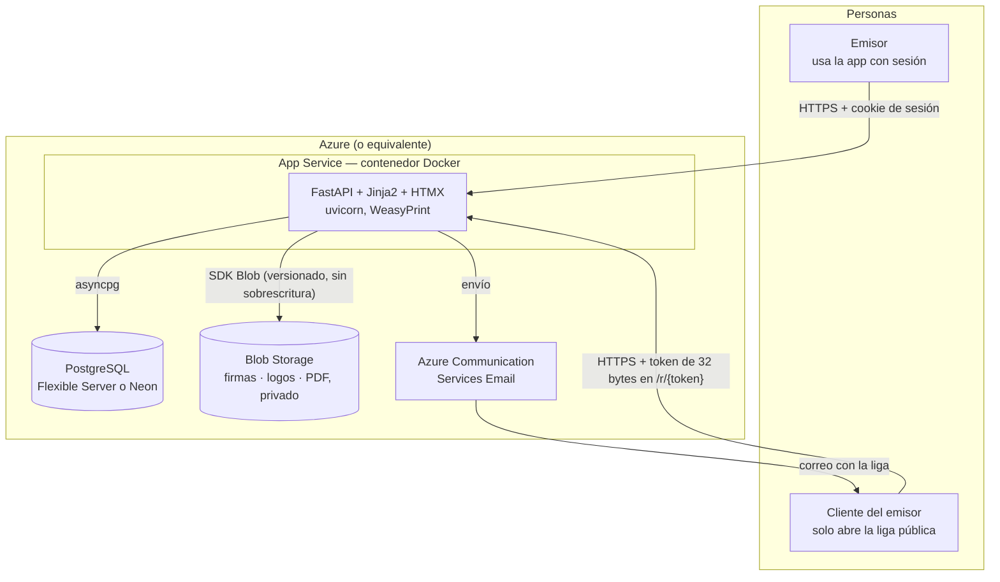
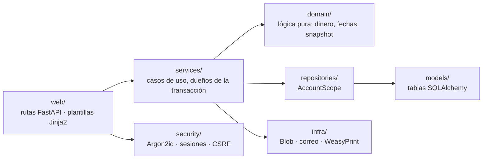
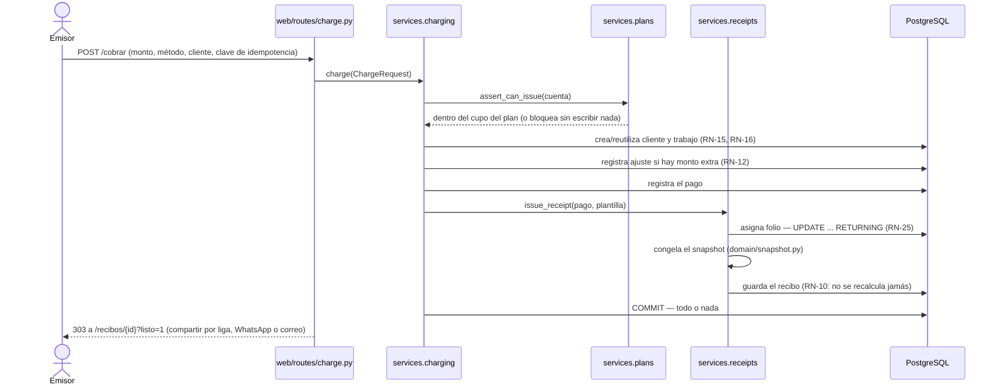
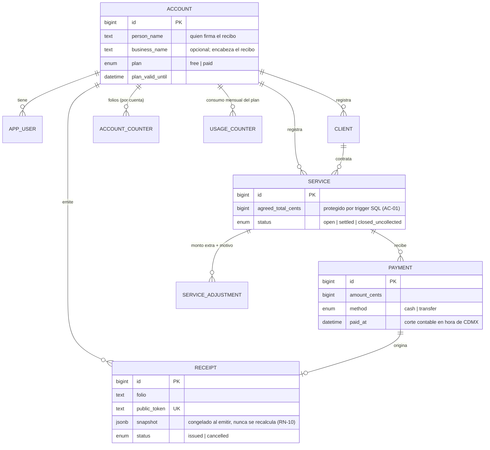

# Recibo — plataforma de comprobantes de pago no fiscales

Aplicación web para que un prestador de servicios **genere, entregue y conserve
comprobantes de pago no fiscales**, y lleve el control de lo cobrado y lo
pendiente de cobro.

**No es un producto fiscal.** No timbra ante el SAT, no genera XML, no requiere
PAC y no calcula impuestos. Cualquier tarea de cumplimiento fiscal está fuera de
alcance de forma permanente en la v1.

La fuente de verdad del producto es [`prd-plataforma-recibos.md`](prd-plataforma-recibos.md).
Las reglas de negocio (`RN-nn`) y los criterios de aceptación (`AC-nn`) son
inviolables: si una decisión de implementación entra en conflicto con una,
gana la regla.

---

## Tabla de contenido

- [El problema y la solución](#el-problema-y-la-solución)
- [Características principales](#características-principales)
- [Arquitectura](#arquitectura)
- [Stack tecnológico](#stack-tecnológico)
- [Estructura del proyecto](#estructura-del-proyecto)
- [Puesta en marcha en local](#puesta-en-marcha-en-local)
- [Configuración (variables de entorno)](#configuración-variables-de-entorno)
- [Pruebas](#pruebas)
- [Calidad de código](#calidad-de-código)
- [Despliegue](#despliegue)
- [Seguridad](#seguridad)
- [Decisiones de diseño notables](#decisiones-de-diseño-notables)
- [Estado del proyecto](#estado-del-proyecto)
- [Documentación adicional](#documentación-adicional)

---

## El problema y la solución

El usuario de validación es un electricista a domicilio en Ciudad de México:
15–20 trabajos al mes, cobro casi siempre en efectivo, contacto con clientes
por WhatsApp y control de pagos anotado en las notas de su celular. Tuvo dos
conflictos reales con clientes por **fallos de memoria de ambas partes**: uno
olvidó cuánto había abonado, en otro caso hubo confusión sobre el monto
acordado porque pasó tiempo entre el acuerdo y el cobro.

No hacía falta firma con validez legal, ni biometría, ni blockchain. Hacía
falta que las dos partes tuvieran **una copia fechada de lo acordado y de cada
abono**, disponible cuando la memoria falle. El recibo, entonces, no es solo
comprobante de pago: es la memoria del acuerdo.

**El momento de verdad** ocurre de pie, en la puerta de una casa, justo después
de cobrar en efectivo. Si el flujo completo de emisión no se resuelve en menos
de un minuto, el producto no se usa — toda decisión de interfaz se subordina a
esto.

El cliente del emisor **no instala nada, no crea cuenta y no inicia sesión**:
solo recibe una liga o un papel.

## Características principales

| Área | Qué resuelve |
|---|---|
| **Cuenta y emisor** | Registro, login, recuperación de contraseña, perfil del emisor con logo y firma capturados una sola vez (recapturables) |
| **Directorio de clientes** | Alta reutilizable, búsqueda sin acentos, alta *dentro* de la transacción de cobro para no dejar registros sueltos |
| **Trabajos y pagos** | Trabajo con total acordado, montos extra documentados con motivo, pagos parciales múltiples, saldo siempre visible |
| **Pantalla de cobro (`/cobrar`)** | Un formulario, un botón, una transacción: selecciona o crea cliente, continúa o abre trabajo, registra el pago y emite el recibo — todo en menos de un minuto, con protección contra doble clic (idempotencia) |
| **Recibos** | Folio secuencial por cuenta, dos plantillas (sencilla y detallada), firma del cliente opcional con nombre y calidad de quien firma, cancelación con motivo |
| **PDF y liga pública** | PDF generado bajo demanda y cacheado; página pública permanente en `/r/{token}`, sin sesión, sin indexar |
| **Compartir** | Copiar liga, compartir por WhatsApp, envío por correo real (Azure Communication Services) |
| **Contabilidad** | Panel con lo ganado del mes y lo pendiente de cobro, comparación mensual, vista de "quién me debe", reporte descargable en CSV |
| **Planes y límites** | Plan gratuito con cupo mensual de recibos y aviso previo al tope, plan de pago, cupones de descuento |
| **Aviso de privacidad** | `/privacidad`, servido sin sesión, con inventario de datos verificado contra el esquema real en cada corrida de pruebas |

Fuera de alcance de forma permanente (`[NO-OBJETIVO]` del PRD): apps nativas,
modo sin conexión, integración con WhatsApp Business API, recordatorios
automáticos de cobro, multiusuario/roles, analítica con IA, y cualquier
funcionalidad fiscal.

## Arquitectura

### Vista de despliegue



En desarrollo, `PostgreSQL` y `Blob Storage` se sustituyen por contenedores
locales (`postgres:16-alpine` y `azurite`) orquestados por `compose.yaml`; el
correo se escribe al log en vez de enviarse. La aplicación es un único
contenedor sin estado: toda persistencia vive en Postgres y en el blob.

### Capas del código

Las dependencias van en un solo sentido — una capa nunca importa de la que
tiene a la derecha:



`domain/` no importa nada de SQLAlchemy, FastAPI ni I/O: es donde viven las
reglas de negocio (`RN-nn`), probadas en milisegundos y sin base de datos.

### El flujo central: cobrar y emitir

`POST /cobrar` es la transacción que sostiene todo el producto — selecciona o
da de alta al cliente, abre o continúa un trabajo, registra el pago y emite el
recibo con su folio y su snapshot, en una sola unidad atómica:



Si algo falla a mitad de camino, no queda ni pago sin recibo ni recibo sin
pago: la transacción la controla `services/charging.py`, no cada escritura por
separado. El PDF **no** se genera aquí — se genera bajo demanda la primera vez
que alguien lo descarga y se cachea en el blob, para que un fallo del
renderizador nunca tire un cobro que ya ocurrió.

### Modelo de datos (simplificado)



`app_user` es el nombre real de la tabla de usuarios (`user` es palabra
reservada en PostgreSQL). Quedan fuera del diagrama, por brevedad,
`AuthToken` (recuperación de contraseña y verificación de correo), `Coupon` /
`CouponRedemption` y `PlanBlockEvent` (auditoría de topes de plan).

## Stack tecnológico

| Capa | Tecnología |
|---|---|
| Lenguaje / runtime | Python 3.12 |
| Framework web | FastAPI + Uvicorn (ASGI, asíncrono) |
| Plantillas | Jinja2, server-rendered |
| Interactividad en cliente | HTMX + JavaScript plano vendorizado (sin Alpine, sin CDN — ver [CSP](#seguridad)) |
| ORM / migraciones | SQLAlchemy 2.x (async) + Alembic |
| Base de datos | PostgreSQL 16 |
| Almacenamiento de archivos | Azure Blob Storage (Azurite en local) |
| Generación de PDF | WeasyPrint (HTML + CSS → PDF, vía Pango) |
| Autenticación | Cookies de sesión firmadas (`itsdangerous`), contraseñas con Argon2id |
| Correo | Azure Communication Services Email (o consola en desarrollo) |
| Firma en pantalla | `signature_pad` (canvas), vendorizado |
| Contenedores | Docker + Docker Compose |
| Pruebas | pytest, pytest-asyncio, httpx |
| Calidad | ruff (lint + formato), mypy (estricto en `domain/`) |
| CI | GitHub Actions |

## Estructura del proyecto

```
src/receipt/
  domain/        Lógica pura: dinero, fechas, cálculos, snapshot, planes. Sin I/O.
  models/        Tablas de SQLAlchemy.
  repositories/  Acceso a datos acotado por cuenta (AccountScope).
  services/      Casos de uso. Dueños de la transacción.
  security/      Argon2id, sesiones, CSRF, cabeceras, límite de intentos.
  web/           Rutas delgadas, plantillas Jinja2, estáticos.
  infra/         Blob Storage, correo y PDF (WeasyPrint).
migrations/      Migraciones de Alembic.
tests/
  unit/          Dominio puro, sin base de datos.
  integration/   Contra PostgreSQL y Azurite reales.
docs/            Guías de despliegue, correo y deuda técnica.
```

`signature_pad` y `htmx` están vendorizados en `web/static/js/` con la versión
fijada en un comentario: la CSP es `script-src 'self'`, y un CDN ahí sería un
tercero con permiso de ejecutar código sobre datos de cobro.

## Puesta en marcha en local

**Requisito único: Docker Desktop.** No hace falta instalar Python ni
PostgreSQL en la máquina — y en Windows, tampoco el runtime de GTK que
WeasyPrint necesita.

```bash
cp .env.example .env          # ajusta SESSION_SECRET si vas a exponer el puerto
docker compose up -d --build
docker compose run --rm app alembic upgrade head
```

La aplicación queda en <http://localhost:8000>. Crea tu cuenta en `/registro`.

**Todo corre dentro de Docker a propósito.** WeasyPrint renderiza a través de
Pango, y una versión distinta de Pango cambia tipografías y saltos de línea: un
recibo que se ve bien en tu máquina se vería distinto en producción. Usar la
misma imagen en desarrollo, en CI y en Azure elimina esa clase de sorpresa.

### Comandos frecuentes

```bash
docker compose run --rm app pytest                 # suite completa
docker compose run --rm app pytest tests/unit      # solo dominio, sin base de datos
docker compose run --rm app ruff check . && docker compose run --rm app ruff format .
docker compose run --rm app mypy src/receipt

docker compose run --rm app alembic revision --autogenerate -m "descripción"
docker compose run --rm app alembic upgrade head
docker compose run --rm app alembic check          # ¿falta generar alguna migración?

docker compose logs -f app
docker compose exec db psql -U receipt -d receipt
```

## Configuración (variables de entorno)

Se leen desde `.env` (ver [`.env.example`](.env.example)).

| Variable | Obligatoria | Descripción |
|---|---|---|
| `ENVIRONMENT` | No (`development`) | `development` \| `test` \| `production` |
| `DEBUG` | No | Activa el log detallado |
| `SQL_ECHO` | No | Volcado de cada sentencia SQL; aparte de `DEBUG` porque ahoga el log |
| `DATABASE_URL` | Sí | Cadena `postgresql+asyncpg://...` |
| `TEST_DATABASE_URL` | No | Base separada para la suite (`receipt_test`) |
| `SESSION_SECRET` | Sí | Firma las cookies de sesión; aleatorio y largo en producción |
| `AZURE_STORAGE_CONNECTION_STRING` | Sí | Cadena de conexión de Blob Storage (Azurite en local) |
| `BLOB_CONTAINER` | No (`receipts`) | Contenedor de blobs, privado |
| `PUBLIC_BASE_URL` | Sí en producción | Dominio base de las ligas públicas de recibo |
| `MAIL_BACKEND` | No (`console`) | `console` (log) \| `memory` (pruebas) \| `azure` (envío real) |
| `MAIL_FROM` | No | Remitente que muestra `ConsoleMailer` |
| `ACS_CONNECTION_STRING` / `ACS_SENDER_ADDRESS` | Solo con `MAIL_BACKEND=azure` | Credenciales de Azure Communication Services; sin ellas la app no arranca |
| `LEGAL_RESPONSABLE` / `LEGAL_DOMICILIO` / `LEGAL_CONTACTO_ARCO` | Sí en producción | Identidad del responsable en `/privacidad` (art. 15 LFPDPPP) |
| `LOGIN_MAX_ATTEMPTS` / `LOGIN_WINDOW_SECONDS` | No | Límite de intentos de login y recuperación |
| `PUBLIC_RECEIPT_MAX_REQUESTS` / `PUBLIC_RECEIPT_WINDOW_SECONDS` | No | Límite contra enumeración de `/r/{token}` |

`MAIL_BACKEND=console` (valor por omisión) escribe el correo al log en lugar de
enviarlo; la liga de recuperación aparece en `docker compose logs -f app`.
`MAIL_BACKEND=azure` envía de verdad — ver
[`docs/correo-azure-alta.md`](docs/correo-azure-alta.md) para el alta de los
recursos.

## Pruebas

```bash
docker compose run --rm app pytest                 # suite completa
docker compose run --rm app pytest tests/unit       # dominio puro, sin base de datos
docker compose run --rm app pytest -m "not db"       # todo lo que no toca PostgreSQL
```

- `tests/unit/` prueba las reglas de negocio en milisegundos, sin base de datos.
- `tests/integration/` corre contra **PostgreSQL y Azurite reales**, no contra
  dobles en memoria: `AC-01` exige que la inmutabilidad de `agreed_total_cents`
  falle también por SQL directo, y eso lo sostiene un trigger que solo existe en
  PostgreSQL de verdad. El esquema de pruebas se construye aplicando las
  migraciones, no con `metadata.create_all`, para que las pruebas ejerciten los
  triggers y restricciones reales.
- Cada prueba corre dentro de una transacción que se revierte al terminar.
- Hay una prueba de contrato entre el JavaScript y las plantillas
  (`test_javascript_contract.py`): no hay navegador en la suite, así que sin
  ella un atributo renombrado dejaría una pantalla muerta sin que fallara nada
  del servidor.
- Una prueba recorre `app.routes` por introspección y comprueba que cada
  recurso con ID responde 404 a una cuenta ajena (`AC-13`): las rutas nuevas
  quedan cubiertas sin tocar esa prueba.

Según el corte de deuda técnica más reciente ([`docs/pendientes.md`](docs/pendientes.md)),
la suite tiene 609 pruebas en verde.

## Calidad de código

```bash
docker compose run --rm app ruff check .            # lint
docker compose run --rm app ruff format --check .   # formato
docker compose run --rm app mypy src/receipt         # tipado
```

`mypy` corre en modo estricto sobre `domain/` — es la capa que sostiene las
reglas de negocio — y en modo normal sobre el resto. El pipeline de CI
([`.github/workflows/ci.yml`](.github/workflows/ci.yml)) ejecuta lint, formato,
tipado, la suite completa y comprueba que las migraciones revierten y se
vuelven a aplicar (`upgrade head → downgrade base → upgrade head`), todo dentro
de la misma imagen Docker que se despliega.

## Despliegue

Guía completa, con costos y comandos de `az` paso a paso, en
[`docs/despliegue-azure.md`](docs/despliegue-azure.md). Resumen:

| Recurso | Para qué |
|---|---|
| Azure Container Registry | Guarda la imagen de la aplicación |
| PostgreSQL (Azure Database Flexible Server, o Neon) | Datos |
| Azure Blob Storage | Firmas, logos y PDF de recibos, contenedor privado |
| App Service (Linux, plan B1) para contenedores | Cómputo |
| Azure Communication Services | Envío real de correo (opcional en demo) |

Se despliega **como contenedor, no como código fuente**: la imagen fija las
librerías nativas de Pango que WeasyPrint necesita, así que un recibo se ve
igual en tu máquina, en CI y en producción. El costo aproximado de un entorno
de demostración va de ~18 a ~40 USD/mes según se use PostgreSQL administrado o
Neon (que se apaga solo tras inactividad).

Antes de mostrar el producto a un cliente real hace falta, además, dar de alta
el envío real de correo (`MAIL_BACKEND=azure`,
[`docs/correo-azure-alta.md`](docs/correo-azure-alta.md)) y las variables del
aviso de privacidad (`LEGAL_*`).

## Seguridad

- **Contraseñas** con Argon2id; sesión en cookie `HttpOnly` + `Secure` +
  `SameSite=Lax`, firmada con `SESSION_SECRET`.
- **CSRF**: token de sesión verificado en toda ruta que muta estado bajo
  sesión (`security/csrf.py`), como segunda capa sobre `SameSite=Lax`.
- **Aislamiento por cuenta**: ninguna ruta acepta un `account_id` por
  parámetro; `AccountScope` lo toma de la sesión firmada y un modelo sin regla
  de alcance registrada no se puede consultar — falla al construir la query,
  no en producción (`AC-13`).
- **CSP estricta** (`script-src 'self'`): sin scripts de terceros ni CDNs;
  `htmx` y `signature_pad` están vendorizados con la versión fijada.
- **Límite de intentos** en login, recuperación de contraseña y en la liga
  pública del recibo (`/r/{token}`), para impedir fuerza bruta y enumeración de
  tokens de 32 bytes.
- **`/r/{token}`** es la única consulta sin sesión: el token es la credencial,
  y un token inválido responde 404 indistinguible de uno inexistente.
- **Blobs versionados, nunca sobrescritos**: cada firma o logo escribe una ruta
  nueva, así que pisar un blob no puede alterar en silencio un recibo ya
  emitido.
- **`agreed_total_cents`** lo protege un trigger de PostgreSQL, no solo la capa
  de aplicación (`AC-01`): modificarlo falla también por SQL directo.

## Decisiones de diseño notables

Estas decisiones no son obvias leyendo el código aislado; se documentan aquí
para no volver a discutirlas cada vez:

- El **recibo emitido nunca se recalcula** (`RN-10`): su contenido vive
  congelado en `receipt.snapshot`, y tanto la página pública como el PDF se
  renderizan solo desde ahí.
- El **PDF se genera bajo demanda** y se cachea en el blob; cancelar o firmar
  el recibo invalidan la caché para que la siguiente descarga regenere.
- Un **sobrepago se rechaza**: un monto mayor al saldo es un aumento de precio
  sin documentar, y toda alza exige motivo.
- El **cupo del plan gratuito se cuenta por mes de emisión**; el ingreso
  reportado, por fecha de pago (`paid_at`) — son dos cortes distintos porque
  miden cosas distintas.
- **`/cobrar` usa JavaScript plano**, no Alpine, aunque el PRD lo nombre:
  Alpine evalúa expresiones con `new Function()`, lo que exigiría
  `unsafe-eval` justo en la pantalla que maneja datos de cobro.
- La **clave de idempotencia** de `/cobrar` la genera el servidor al pintar la
  pantalla, no el navegador: con mala señal —que es cuando se toca dos veces el
  botón— el JavaScript es precisamente lo que puede no haber cargado.
- Las **rutas visibles van en español** (`/cobrar`, `/recibos`, `/clientes`);
  los identificadores de código van en inglés.
- **Money nunca es `float`**: se opera y se formatea siempre en centavos
  enteros (`domain/money.py`).
- **Todo se almacena en UTC**; el corte contable usa hora de Ciudad de México
  (`domain/clock.py`), para que un pago a las 23:30 del día 31 pertenezca a ese
  mes y no al siguiente.

El razonamiento completo detrás de cada una está en el propio código, citando
la sección del PRD (`§n`), la regla (`RN-nn`) o el criterio (`AC-nn`) que
sostiene.

## Estado del proyecto

| Hito | Alcance | Estado |
|---|---|---|
| 0 | Cimientos: Docker, esquema completo, migraciones, autenticación, CI | **Terminado** |
| 1 | Perfil del emisor, firma, logo, clientes, recuperación de contraseña | **Terminado** |
| 2 | Motor de cobro: servicios, pagos, recibos, snapshot, folios, cancelación | **Terminado** |
| 3 | Plantilla del recibo, PDF, liga pública, firma del cliente | **Terminado** |
| 4 | Pantalla de cobro e idempotencia, compartir — **entregable al usuario real** | **Terminado** |
| 5 | Contabilidad: panel, comparación mensual, quién me debe, CSV | **Terminado** |
| 6 | Planes, límites, cupones, pasarela | **Terminado** |

El detalle de lo pendiente y de la deuda técnica vigente vive en
[`docs/pendientes.md`](docs/pendientes.md), que se verifica contra el código en
cada corte, no se recuerda de memoria.

## Documentación adicional

- [`prd-plataforma-recibos.md`](prd-plataforma-recibos.md) — fuente de verdad del producto: alcance, reglas de negocio y criterios de aceptación.
- [`docs/despliegue-azure.md`](docs/despliegue-azure.md) — guía paso a paso para desplegar en Azure.
- [`docs/correo-azure-alta.md`](docs/correo-azure-alta.md) — alta de Azure Communication Services para envío real de correo.
- [`docs/plan-correo-azure.md`](docs/plan-correo-azure.md) — diseño del adaptador de correo y su manejo de fallos.
- [`docs/pendientes.md`](docs/pendientes.md) — deuda técnica y decisiones abiertas, verificadas contra el código.
- [`CLAUDE.md`](CLAUDE.md) — guía de arquitectura y convenciones para agentes de desarrollo.
